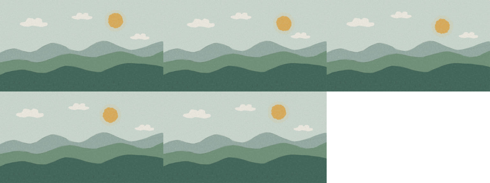

# Validation record — 2026-11-01

Validated in the current Codex Cloud instance; fresh-task snapshot restoration has not been tested.

## Working workflow

- `bash scripts/setup.sh`: passed twice, frozen upstream lockfile, one shared install. Node 24.19.0, npm 11.9.0; esbuild 0.25.12, Three.js 0.170.0, playwright-core 1.63.0, TypeScript 5.9.3.
- Chromium 154.0.8037.57: actual Canvas fill/read succeeded. FFmpeg and ffprobe 7.1.5 were already present and exercised for encoding/decoding.
- `bash scripts/validate-hello.sh`: passed end to end through the final in-memory cloud adapter. It creates PNG, MP4, GIF and HTML, and fails immediately if a required operation fails.
- PNGs at frames 0, 30, 60, 90 and 119: each printed reproducible (two identical hashes). 1280×720 preview; frame 30 at scale 2 is 2560×1440 and reproducible. Contact sheet and decoded MP4 frame 60 were visually inspected. Layered green hills, warm sun, white clouds, paper grain and fine grass strokes render correctly; changes in sun/cloud position are visible across the sheet.
- MP4: H.264/yuv420p, 1280×720, 24 FPS, 120 decoded frames, exactly 5.000 seconds, no audio as intended; verify-export --loop --delivery passed 6/6 checks. Seam changed 0.27% versus a 0.50% ceiling.
- GIF: 1280×720, 24 FPS nominal, 120 decoded frames, exactly 5.000 seconds; verify-export --loop passed 4/4. Seam changed 0.26%. GIF uses centisecond timing, not exact equal 1/24-second frame durations.
- Both video files fully decoded with FFmpeg without reported errors. PNG codec and dimensions independently checked with ffprobe.
- Self-contained HTML: emit passed 15/15, zero external requests, 24 distinct sampled frames matching the generated engine page. Silent audio parity checked.
- Rendering's own six hash probes matched forward versus reversed across two pages.
- Project TypeScript: `node ../../engine/anidoodle/engine/node_modules/typescript/bin/tsc --noEmit` from projects/hello-anidoodle passed.
- New-project smoke: created a separate 1-second 320×180 linked project, rendered a reproducible PNG without npm install, verified refusing an existing project, then removed only that temporary test project.
- 1,310 source/reference/asset files under engine/anidoodle compared byte-for-byte against the upstream pinned skill: zero changes/missing files (dependencies/generated files excluded).

## Checks that failed, and what that means

`gate hello-anidoodle --adapter html-player --mp4 outputs/hello-anidoodle.mp4 --samples 8`: 13/14 passed. Determinism passed across one versus three pages and reverse order; contract scan passed all 343 art modules and 334 seeded call sites; artifact checks passed. No identical consecutive frames. The one failure is the strict motion-area floor: median changed area 0.16%, minimum 0.09%, below 0.5% in its 12-frame windows. This is a gently moving ambient scene, not a high-motion film. The assertion remains intact; the scene is not declared a drawing or exempted to force a pass. Full quality gate is therefore FAIL, despite valid exports.

`npm test` in engine/anidoodle/engine: **2,028 passed, 3 failed**, exit 1. The failing tests compare exact synthesized-audio hashes: nocturne no-bank MD5 (`sampler.test.ts`), and launch cue plans 1/2 SHA-256 (`sfxHarsh.test.ts`). The same three failures were reproduced by `node tools/test.mjs sampler sfxHarsh` in the untouched upstream checkout using the same runtime/dependencies. This establishes they are inherited baseline failures here; the exact audio numerical/runtime cause remains unresolved. They do not involve the silent landscape's rendering. The npm command's five later chained sound-effect unit commands did not run because its first test runner failed. Do not describe the full upstream suite as passing or claim audio readiness.

The upstream playwright adapter lacks the `probe()` API expected by gate/verify-export (gate reports mod.probe is not a function). Use html-player for these commands; ordinary still/render successfully use the Playwright adapter. Remotion and Hyperframes are not installed or tested. Three.js is installed and its upstream hash-pinned code is preserved, but 3D rendering was not tested. WebM/APNG and scores/narration were not tested.

## Cloud and publication

The initial browser download was denied for cdn.playwright.dev. System Chromium works with the studio in-memory document loader; direct file navigation is blocked by managed policy. An earlier HTTP transport attempt produced a correct offline-check failure and was replaced. No checks were removed and upstream engine source is unchanged.

Reusable install_script and start_skill were saved to the environment draft. Added custom destinations: cdn.playwright.dev and storage.googleapis.com for an optional browser-download fallback, api.github.com for PR operations. The existing package-manager network preset is preserved. Review/save in environment settings and publish to activate permanent configuration/snapshot; a draft save alone does not apply runtime network changes.

Git read access works. The specific GitHub API request needed for pull-request creation returns Forbidden in this instance. The PR title/body are prepared in docs/pull-request.md; see the final task report for branch push/PR status. No token was requested or printed.

## Output locations

All full-resolution/generated media lives in `projects/hello-anidoodle/outputs/` and is ignored by Git. The committed small contact sheet below documents visual review; regenerate media with the validation script or retain it in the cloud snapshot/download an archive.

